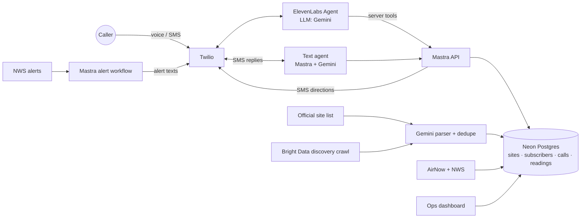

# Shade 🌳 (working name)

**A phone line for finding cool, clean air during heat waves and wildfire smoke.**

Call or text a number, say where you are, and get the nearest *open* cooling center or clean-air space, with today's hours and the current AQI. Directions arrive by text. When the National Weather Service issues a heat or smoke alert, Shade also texts opted-in residents the nearest open site.

Built for SanD Hacks.

---

## The problem

- San Diego County's free cooling centers, called **Cool Zones**, run on a fixed season: **June 1 to October 31**.
- The heat no longer keeps to that season. San Diego hit **~90°F in November 2026**, set records during a **March 2026** heat wave, and had its **longest stretch of heat this intense in almost 100 years** this October.
- Many coastal homes have **no air conditioning**.
- Older adults, people with disabilities, and people without cars or smartphones are hit hardest. They're also the least likely to find a county web page and check whether a site is open today.
- **Almost nobody knows these resources exist.** Most people, college students included, have never heard of Cool Zones or of 211 (the county's free help line). A resource doesn't help anyone who doesn't know about it.
- Even people who know about 211 have to think to call it. Nothing reaches out to people *before* they're in trouble.

## What Shade does

| | Feature | Why it matters |
|---|---|---|
| 📞 | **Inbound voice line**: "I'm in El Cajon, no car, it's really hot." | Works on any phone, with no app and no internet |
| 📍 | **Nearest open site**: filters by open-now hours, travel time, AQI, and how crowded the site is | Live status, not a static list |
| 💬 | **SMS follow-up**: address, hours, map link, bus route | Callers don't have to remember an address read out loud |
| 🌐 | **Multilingual**: English, Spanish, Tagalog, Vietnamese, Chinese | Covers San Diego's major language communities |
| 🔔 | **Outbound alerts**: on an NWS heat or smoke alert, texts opted-in residents the nearest open site; they can reply to chat with a text agent *(channel TBD: SMS first, voice calls as stretch)* | Proactive, which 211 isn't |
| 🚨 | **Emergency escalation**: if a caller describes heat-illness symptoms, tell them to call 911 | Safety first; the line never stands in for 911 |
| 📊 | **Ops dashboard**: heat, AQI, and call volume by zip code over time | Shows the county where demand is building |

### Where the sites come from
Sites come from two sources, kept separate so the agent can be honest about how sure it is:

| Tier | Source | How the agent presents it |
|---|---|---|
| **Official** | Predefined list: county Cool Zones, city cooling centers | "This is an official cooling center." |
| **Discovered** | Bright Data crawl for places usually open to the public: libraries, community and rec centers, senior centers, malls | "This library is open until 8 and should have AC. You may want to call ahead." |

- A discovered site is recommended only if Gemini finds **today's hours on the site's own page**.
- Discovered sites are matched against the official list by address and location, so the same place doesn't show up twice.

**Clean air space:** an indoor, air-conditioned site from either tier whose local AQI is better than the caller's. Most sites don't publish whether they filter their air, so we flag filtration only where a source says so.

---

## Architecture



### Call flow (inbound)
1. A Twilio number routes the call to the **ElevenLabs agent**. The agent says up front that it's an AI.
2. The agent gets the caller's location (zip, neighborhood, or cross streets), language, and needs (has a car? mobility issues?).
3. The agent calls the server tool `find_sites({ location, needs })`, which returns the top 2 sites.
4. The agent reads out the best option, and on request calls `send_sms({ to, site_id })`.
5. The call is logged in Neon.

**No crawling happens during a call.** Ingest and discovery run on a schedule and whenever an alert fires, so a lookup is just a database read and the agent answers right away.

### Alert flow (outbound, SMS first)
1. A Mastra workflow polls NWS active alerts for San Diego County zones.
2. On a new *Extreme Heat Warning*, *Heat Advisory*, or *Air Quality Alert*, the workflow re-crawls and refreshes site status for the affected zips.
3. It texts opted-in subscribers in those zips the nearest open site, with hours, AQI, and a map link.
4. Replies ("no car", "something closer?", "en español") go to a **text agent** that uses the same `find_sites` tool. It also gives 211's number for free rides.
5. *Stretch:* outbound voice check-in calls through ElevenLabs + Twilio for subscribers who prefer a call.

---

## Sponsor tracks

| Track | How Shade uses it |
|---|---|
| **Bright Data: Data for Good** | Two jobs: (1) scrape the official cooling-center pages, and (2) a **discovery crawl** that searches each zip for libraries, community centers, and other places usually open to the public, then fetches their hours pages. SERP API + Web Unlocker, or the MCP server. |
| **ElevenLabs** | Voice agent on a real phone line, in several languages |
| **Neon** | The only database: sites, subscribers, call records, heat/AQI readings, agent memory. Also powers the dashboard and the site-load estimates. |
| **Gemini API** | Turns messy scraped pages and PDFs into structured site records with parsed hours. Also the agent's LLM inside ElevenLabs. |
| **Mastra** | TypeScript agent + workflow layer: server tools for the voice agent, the SMS text agent, and the alert → re-crawl → text workflow |
| **GoDaddy Registry** | Project domain |
| **DEV** | Post-event write-up |
| **Best Overall** | Real phone call live on stage, ranking that accounts for site capacity, plus outbound alerts |

---

## Data sources

| Source | Use | Notes |
|---|---|---|
| County / City of San Diego cooling-center pages | **Official** site list, addresses, hours | Scraped with Bright Data, normalized by Gemini |
| Bright Data SERP API discovery queries | **Discovered** sites: e.g. "community center near {zip}", "public library {city}", "senior center {neighborhood}" | Results vary from run to run, so they're deduped and need hours found on the site's own page |
| Each discovered site's own hours page | Open-now status, AC and public-access clues | Fetched with Web Unlocker; Gemini extracts hours + a confidence score |
| [NWS API](https://www.weather.gov/documentation/services-web-api) | Active alerts, temperature forecasts | Free, no key; requires a `User-Agent` header |
| [AirNow API](https://docs.airnowapi.org/) | Current AQI by zip or lat/long | Free key. ⚠️ The old `/aq/observation/zipCode/current/` endpoint was retired Sept 30, 2026: use `/aq/observation/current/ziplatlong/`. Limited to 500 requests/hour per key, so cache. |
| PurpleAir (stretch) | Finer-grained, sensor-level AQI | Key required |
| MTS GTFS (stretch) | Bus routes to the site | MVP sends a map link instead |

Every site record stores `source_url` and `last_verified_at`. The agent never presents a site as open if its data is stale.

---

## Data model (sketch)

```sql
-- Neon
create table sites (
  id serial primary key,
  name text, kind text,               -- library | rec_center | community_center | senior_center | mall | cool_zone
  tier text,                          -- official | discovered
  confidence real,                    -- Gemini extraction confidence (discovered only)
  address text, lat double precision, lon double precision,
  hours jsonb,                        -- weekly schedule + exceptions
  capacity_est int,
  has_filtration boolean,             -- null = unknown
  source_url text, last_verified_at timestamptz
);
create table subscribers (
  id serial primary key,
  phone_hash text unique, language text, zip text,
  needs jsonb, consent_at timestamptz  -- explicit opt-in required
);
create table calls (
  id serial primary key, direction text, phone_hash text,
  zip text, language text, site_id int references sites, outcome text,
  started_at timestamptz
);
create table readings (
  time timestamptz, zip text,
  temp_f real, heat_index real, aqi int, source text
);
create index on readings (zip, time desc);
create index on calls (site_id, started_at desc);  -- for recent_referrals()
```

### Site ranking
```
candidates = sites open now AND verified recently AND within radius
score = travel_minutes
      + w_aqi  * max(0, site_aqi - 50)
      + w_load * (recent_referrals(site, 2h) / capacity_est)
      + w_tier * (tier == 'discovered') * (1 - confidence)
return top 2 by lowest score
```
- The load term spreads callers across nearby sites so one library doesn't fill up while another sits empty.
- The tier term prefers official sites unless a discovered site is much closer and its hours are high-confidence.
- Stretch goal: solve it as a capacity-constrained assignment problem.

---

## Demo script (~3 min)

1. **Hook (30s):** "Show of hands: who knows where the nearest cooling center is?" *(expect no hands)* "San Diego County runs a whole network of free ones called Cool Zones. They closed October 31, and last week it was 90 degrees. The problem isn't only that they close; it's that nobody knows they exist."
2. **Live call (60s):** A judge dials the number and says "I'm in El Cajon, I don't have a car." The agent gives a site and bus route, and the judge's phone gets the SMS.
3. **Language switch (20s):** The caller switches to Spanish mid-call.
4. **Outbound (40s):** Trigger a mock NWS alert. A teammate's phone gets a text with the nearest open site; they reply "no car" and the text agent answers.
5. **Dashboard (30s):** Call map, heat and AQI over time by zip, and site load being spread across sites.
6. **Close (10s):** Impact and the data sources behind it.

---

## Build plan

**P0: must work for the demo**
- [ ] Twilio number connected to an ElevenLabs agent (inbound) **← do this first; it's the riskiest piece**
- [ ] Official list: Bright Data scrape + Gemini parsing loads real Cool Zone / city sites into Neon
- [ ] Discovery crawl for the demo zips (El Cajon, La Jolla, City Heights…) with official/discovered tiers and dedupe (keep a cached snapshot as a fallback)
- [ ] `find_sites` server tool with open-now, distance, and tier filtering
- [ ] `send_sms` with address and map link
- [ ] AirNow AQI lookup with caching
- [ ] Agent prompt: AI disclosure at the start, 911 escalation, English and Spanish

**P1**
- [ ] Mastra alert workflow: NWS poll → re-crawl → SMS alerts (with a mock-alert button for the demo)
- [ ] SMS text agent for replies, reusing `find_sites`
- [ ] Ops dashboard (on Neon)
- [ ] Load-aware ranking

**P2**
- [ ] Outbound voice check-in calls
- [ ] Tagalog, Vietnamese, Chinese
- [ ] MTS transit directions
- [ ] Capacity-constrained assignment

---

## Safety & ethics

- **Not an emergency service.** The agent screens for heat-illness symptoms (confusion, fainting, hot dry skin) and tells the caller to call 911.
- **AI disclosure** at the start of every call.
- **Outbound texts and calls are opt-in only.** We record explicit consent and let people opt out by replying "STOP".
- **Honest about confidence.** Discovered sites are labeled as such and come with "call ahead."
- **Minimal personal data.** Phone numbers are hashed at rest, and we store no names.
- **No stale info.** Each site's `last_verified_at` gates whether the agent recommends it.

---

## Repo layout (proposed)

```
shade/
├── apps/
│   ├── api/          # Mastra server: tools, workflows, Twilio/ElevenLabs webhooks
│   └── dashboard/    # ops dashboard (Neon)
├── ingest/           # Bright Data scrapers + Gemini normalizer
├── agent/            # ElevenLabs agent prompt + tool configs
└── db/
    └── schema.sql    # Neon
```

### Environment variables
```
ELEVENLABS_API_KEY=        ELEVENLABS_AGENT_ID=     ELEVENLABS_PHONE_NUMBER_ID=
TWILIO_ACCOUNT_SID=        TWILIO_AUTH_TOKEN=       TWILIO_PHONE_NUMBER=
BRIGHTDATA_API_TOKEN=      GEMINI_API_KEY=          AIRNOW_API_KEY=
NEON_DATABASE_URL=         NWS_USER_AGENT="shade (contact@email)"
```

---

## References

- [Cool Zones season: June 1–Oct 31 (SDG&E)](https://marketplace.sdge.com/node/8491)
- [November 2026 heat wave (NBC 7)](https://www.nbcsandiego.com/weather/where-is-fall-san-diego-temperatures-soar-near-90-degrees-amid-november-heat-wave/4099006/)
- [March 2026 heat wave (NBC 7)](https://www.nbcsandiego.com/news/local/san-diego-continues-to-swelter-under-late-winter-heat-wave/3996604/?amp=1)
- [October 2026 heat records (Axios)](https://www.axios.com/local/san-diego/2026/10/08/san-diego-airport-october-weather-warm-nights)
- [Many coastal homes lack AC (Wego)](https://blog.wego.com/san-diego-heat-wave/)
- [211 for Cool Zone locations and free rides (KPBS)](https://www.kpbs.org/news/quality-of-life/2024/06/03/san-diego-county-opens-cool-zone-sites-as-warmer-weather-approaches)
- [ElevenLabs: Twilio integration](https://elevenlabs.io/docs/conversational-ai/phone-numbers/twilio-integration/outbound-calling) · [Outbound call API](https://elevenlabs.io/docs/eleven-agents/api-reference/twilio/outbound-call) · [Supported LLMs](https://elevenlabs.io/docs/eleven-agents/customization/llm)
- [AirNow API 2026 endpoint changes (PDF)](https://docs.airnowapi.org/docs/AirNowAPIUpdates2026June.pdf)
